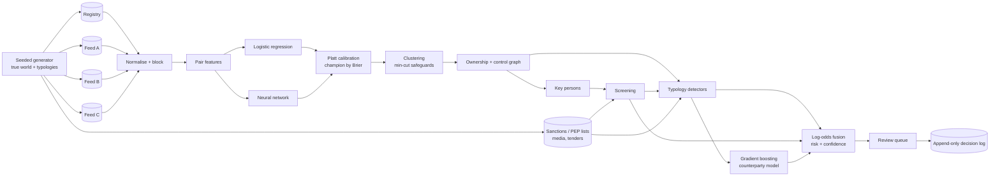

# kyc-energy-graph

KYC and AML due diligence for the energy and utilities sector: entity resolution across a company registry and several commercial data feeds, ownership and control graphs, identification of key persons, and confidence-scored risk assessments of those people and their activities.


## What it demonstrates

- **Entity resolution on messy sources**: Cyrillic transliteration, legal-form stripping, spelling-variant folding and phonetic keys; blocking with pair-completeness and reduction-ratio reporting; explainable pairwise features (name similarity, weakest-token alignment, birth date, address, identifiers, shared officers); clustering with transitive-closure safeguards (cannot-link constraints resolved by minimum cut).
- **Machine learning and neural networks** for match scoring: a logistic-regression baseline and a small multi-layer perceptron, both calibrated with Platt scaling and compared on precision, recall, F1, Brier score and calibration error; a calibrated gradient-boosting model scores counterparties alongside the rule-based detectors.
- **Ownership and control graph**: effective ownership through layered and circular holdings (integrated ownership, `T = A (I - A)^-1`), ultimate beneficial owners at a configurable threshold, majority-chain control, board control, a senior-managing-official fallback, betweenness and articulation-point (bridge) roles.
- **Screening** of resolved persons against a synthetic sanctions list and PEP list, with a birth-date veto, name-rarity penalty and a hit / possible split to keep false positives out of the risk score.
- **Six typology detectors** with ground truth: hidden owner behind offshore layers and nominee directors, circular ownership, PEP behind a supplier winning utility tenders, shell clusters sharing addresses and officers, sanctioned person three ownership hops away, front company incorporated shortly before a tender award.
- **Evidence fusion in log-odds** with per-source reliability estimated from agreement with the registry; every key person and counterparty gets a risk score and a separate confidence (data quality, provider agreement, resolution certainty), and every score lists its evidence chain (records and edges).
- **Human review**: cases above a risk threshold or below a confidence threshold enter a queue; analyst decisions go to an append-only, hash-chained log that detects edits and deletions.

## Architecture



The generator builds a fictional country's energy sector (utilities, EPC contractors, renewables, traders, holdings, offshore vehicles), injects the typologies, and renders that world through four sources with different coverage and noise. Two further worlds with different seeds train the match models, pick the champion model per entity kind, and train the counterparty model, so every metric below is measured on data no model has seen. Resolution produces entities with a link confidence; the graph lifts every source relation onto those entities and fuses disagreeing share percentages by source reliability. Detectors, screening and the learned model all emit `Evidence` objects carrying records and edges, and the fusion step is the only place where they become a number.

## Quickstart

Requires Python 3.12+. Dependencies: networkx, numpy, scikit-learn (dev: pytest, ruff).

```bash
python3 -m venv .venv && . .venv/bin/activate
pip install -e ".[dev]"

kyc-graph generate                      # writes data/dataset.json (seed 7)
kyc-graph resolve                       # ER metrics, model comparison, source reliability
kyc-graph resolve --explain REG:VR-008510 B:B00157   # why two records match
kyc-graph assess VR-008510              # Markdown report: ownership tree, key persons, evidence
kyc-graph run-all                       # full pipeline, metrics per typology, fails below floors
kyc-graph review queue                  # open cases
kyc-graph review decide VR-008510 --decision escalate --analyst analyst1 --note "3-hop sanctions exposure"
kyc-graph review verify                 # check the hash chain of the decision log

ruff check .
pytest
```

An example report is committed at [docs/examples/assessment-VR-008510.md](docs/examples/assessment-VR-008510.md): a contractor whose 22.9% indirect owner (below the UBO threshold, but in control through a majority chain) matches the sanctions list three hops up.

### Results on the default seed

Match models on out-of-sample candidate pairs (threshold 0.5):

| kind | model | calibration | precision | recall | F1 | Brier | cluster F1 |
|---|---|---|---|---|---|---|---|
| company | logistic | none | 0.999 | 1.000 | 0.999 | 0.0001 | 0.996 |
| company | logistic | Platt | 0.999 | 0.994 | 0.996 | 0.0003 | 0.995 |
| company | neural net | none | 0.996 | 0.991 | 0.994 | 0.0005 | 0.990 |
| company | neural net | Platt | 0.996 | 0.988 | 0.992 | 0.0007 | 0.990 |
| person | logistic | none | 0.997 | 0.988 | 0.992 | 0.0060 | 0.987 |
| person | logistic | Platt | 0.997 | 0.988 | 0.992 | 0.0061 | 0.987 |
| person | neural net | none | 0.989 | 0.988 | 0.988 | 0.0082 | 0.986 |
| person | neural net | Platt | 0.989 | 0.988 | 0.988 | 0.0091 | 0.986 |

The champion is chosen on a separate validation world, not on this table: logistic regression wins for companies, the neural network wins for persons on validation, and on the evaluation world the two are within a few thousandths of each other. With hand-built features that already encode the domain, the extra capacity of the network buys little; the comparison is there to show that, not to hide it.

Pipeline (`kyc-graph run-all`): clustered ER F1 0.995 (companies) and 0.986 (persons); screening precision and recall 1.00 on 13 true list matches, with namesake decoys in both the lists and the registry; precision and recall 1.00 for every typology; fused risk AUC 1.00; 56 review cases, of which 22 are low-confidence only. Other seeds (11, 23) give ER F1 above 0.97, typology F1 1.00 and screening precision 0.93 to 1.00. These numbers are high because the generator is the test oracle; the point is the wiring and the failure modes, not the score.

## Design decisions

1. **Risk and confidence are two numbers, not one.**
   Why: a counterparty with no adverse evidence that exists only in one noisy feed is not "low risk", it is "unknown". Folding data quality into the risk score would hide that. Confidence combines completeness, provider agreement and resolution certainty, and low confidence alone routes a case to review.
   Trade-off: analysts see two numbers and need a policy for the quadrants; the review queue encodes that policy as two thresholds.

2. **Integrated ownership instead of path enumeration.**
   Why: `T = A (I - A)^-1` sums all ownership walks in one matrix solve, handles cross-holdings without special cases, and redistributes the circular part to the people at the top, so effective stakes in a company add up to what natural persons really hold. A simple-path variant stays in the code as a cross-check.
   Trade-off: walks around a cycle are counted repeatedly, which some regulatory readings would not do; a fully closed structure (spectral radius 1) has no ultimate owner and is rejected explicitly.

3. **Cannot-link constraints enforced by minimum cut after transitive closure.**
   Why: closure over pairwise links is what chains two different registry persons together through one ambiguous feed record. Cutting the cheapest set of links between the conflicting records (same source, different identifiers, different birth dates) removes exactly the weak bridge and keeps the strong links.
   Trade-off: the cut can isolate a genuinely correct record when it links equally well to two namesakes; those records surface with low link confidence and push their cases to review instead of being guessed.

4. **Discounted log-odds fusion with one item per evidence kind.**
   Why: each item contributes confidence x source weight x ln(LR), which keeps the arithmetic auditable line by line in the report. Counting only the strongest item per kind stops one typology seen through several paths from being counted several times.
   Trade-off: likelihood ratios are expert-set, not learned, and the independence assumption between kinds is optimistic (a sanctions hit and a sanctions-exposure finding are correlated).

5. **The learned counterparty model is one more piece of evidence, not the verdict.**
   Why: gradient boosting over detector outputs and structural features (ownership depth, offshore parents, nominee directors, tender history) catches combinations the rules do not weight, but its output enters fusion as a likelihood ratio against its training base rate with a fixed reliability of 0.5, and its top drivers are listed by occlusion. The fused score stays explainable item by item.
   Trade-off: the model sees detector outputs as features, so part of its signal overlaps the rules; the low reliability weight limits that double counting rather than removing it.

6. **Entity-resolution doubt goes to confidence, not to evidence strength.**
   Why: an early version multiplied every evidence item by the link confidence of the entities on its chain, and a hidden owner who was uncertainly resolved made a real layered structure almost disappear from the risk score. Keeping the two apart means the structure still raises risk while low confidence still sends it to an analyst.
   Trade-off: a wrong merge can now raise risk on the wrong entity; the review queue and the per-entity record list in each report are the mitigation.

## Scope and limits

- All data is synthetic and generated from a seed: one fictional country, one offshore jurisdiction, about 250 companies and 380 persons. Scale, blocking cost and graph algorithms were not tuned for millions of records.
- Screening covers persons only; company-level list screening, vessel and aircraft lists, and secondary sanctions rules are out of scope.
- Adverse media is matched by name with keyword severity; there is no language model, translation or entity linking in free text beyond exact folded-name matches.
- Likelihood ratios, thresholds and floors are expert-set for this synthetic world and would need calibration on investigated cases before any real use.
- Family and close-associate relationships of PEPs are not modelled; a PEP must be a key person of the supplier.
- The decision log is tamper-evident, not tamper-proof: it detects edits and deletions but has no signatures or external anchoring.
- No user interface, no access control and no data retention policy.

## About this lab

A compact reference implementation written in 2026. It reconstructs, on synthetic data, the approach behind a KYC and AML solution I designed in 2018 for energy and utilities companies (entity resolution, ownership graphs, key-person risk), without reproducing any proprietary design.

## License

MIT, see [LICENSE](LICENSE).
